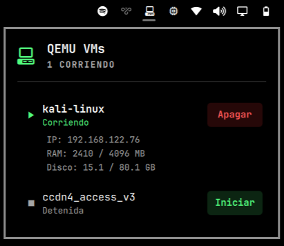

# omarchy-qemu-plugin



QEMU/libvirt VM manager widget for Omarchy. Monitor and control your virtual machines directly from the bar.

## Features

- Lists all VMs registered in libvirt
- Shows state, IP address, RAM and disk usage for running VMs
- Start and stop VMs with one click
- Automatically opens the VM console when starting

## Requirements

- QEMU/libvirt installed and configured
- User in the `libvirt` group
- `virt-manager` installed

## Installation

```bash
omarchy plugin add https://github.com/pacman-vzla/omarchy-qemu-plugin.git --enable
```

## Usage

Click the VM icon in the bar to open the panel. Running VMs show their IP, RAM and disk usage. Click "Iniciar" to start a VM (opens console automatically) or "Apagar" to shut it down gracefully.

## Sudoers

No sudo required — uses `qemu:///system` via libvirt directly.

## Removal

```bash
omarchy plugin disable dix.qemu
omarchy plugin remove dix.qemu
```

## Dependencies

- `qemu` and `libvirt` installed and running
- User must be in the `libvirt` group: `sudo usermod -aG libvirt $USER`
- `virt-manager` for console access
